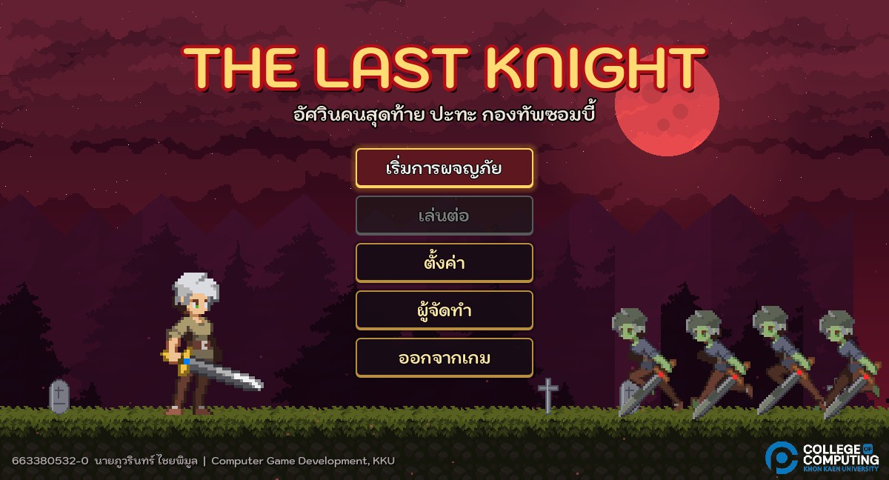
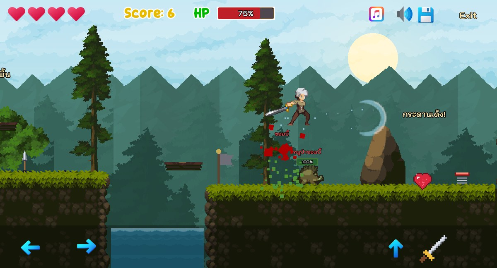
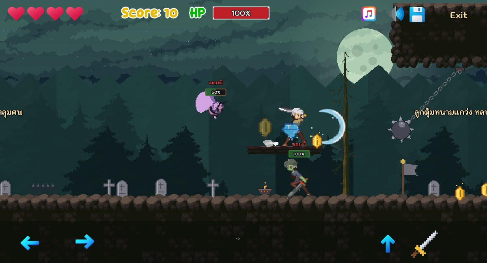
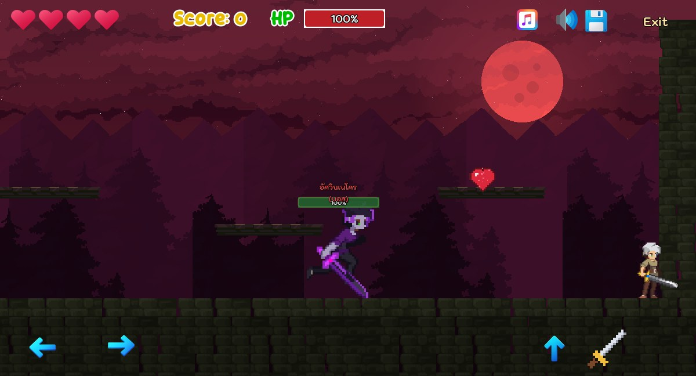

# The Last Knight — อัศวินคนสุดท้าย

เกม 2D Platformer Side-Scrolling สร้างด้วย **Godot 4.7**
แบบฝึกหัดที่ 4 รายวิชา **Computer Game Development** วิทยาลัยการคอมพิวเตอร์ มหาวิทยาลัยขอนแก่น

| รหัสนักศึกษา | ชื่อ-สกุล |
|---|---|
| 663380532-0 | นายภูวรินทร์ ไชยพิมูล |

## ภาพตัวอย่าง

 
 

- ▶️ **Play Game:** https://YOUR-GITHUB-USERNAME.github.io/GameLab4/
- 🎬 **Clip Demo VDO:** (ใส่ลิงก์ YouTube / Google Drive)

## เนื้อเรื่อง (Game Story)

ณ อาณาจักรเอลโดเรีย **"มอร์ธัส"** อดีตแม่ทัพแห่งภาคีอัศวินรุ่งอรุณ ได้ทรยศและทำสัญญากับความตาย
กลายเป็น **อัศวินเนโคร** ปลดปล่อยคำสาปแห่งราตรีนิรันดร์ ผู้คนกลายเป็นซอมบี้ สัตว์ป่าเน่าเปื่อยลุกขึ้นอาละวาด
อัศวินทุกคนล้มลง... เหลือเพียง **"เอเรน"** อัศวินคนสุดท้าย ผู้ถือดาบแห่งรุ่งอรุณที่ปล่อยคลื่นแสงได้
เขาต้องฝ่าผืนป่า สุสาน และบุกปราสาท เพื่อโค่นมอร์ธัสและนำแสงอรุณกลับคืนมา

| ด่าน | ชื่อ | จุดเด่น |
|---|---|---|
| 1 | ชายป่าแห่งรุ่งอรุณ (Dawn Forest) | ด่านสอนเล่น หอกพุ่ง แท่นเลื่อน กระดานเด้ง |
| 2 | ป่าสนยามพลบค่ำ (Twilight Woods) | ใบเลื่อย ลิฟต์ ประตูวาร์ป ยาเร่งความเร็ว |
| 3 | สุสานต้องสาป (Cursed Graveyard) | หลุมศพเกิดซอมบี้ ลูกตุ้มหนาม กองไฟพ่นเปลว |
| 4 | ปราสาทเนโครแมนเซอร์ (Necromancer's Keep) | ด่านกับดักรวม + **บอส อัศวินเนโคร มอร์ธัส** |

## วิธีเล่น

| ปุ่ม | การกระทำ |
|---|---|
| A / D หรือ ← → | เดิน |
| Space / W / ↑ | กระโดด (กดกลางอากาศอีกครั้ง = กระโดด 2 ชั้น) |
| X | ฟันดาบ ปล่อยคลื่นแสง |
| กระโดดเหยียบหัวศัตรู | กำจัดศัตรู (เด้งตัวขึ้น) |

บนมือถือ / เว็บ ใช้ปุ่มบนหน้าจอได้

## สิ่งที่พัฒนาเพิ่มจาก Starter Kit

1. **เมนูใหม่** — ภาพพื้นหลัง, ปุ่มสไตล์ยุคกลาง, ปุ่มออกจากเกม (Exit), หน้าเนื้อเรื่อง, หน้าตั้งค่าเปิด/ปิดเสียง, หน้า Credit
2. **ตัวละคร** — อัศวิน (Idle / Run / Jump / Fall / Attack / Dead) และศัตรู 3 ชนิด + บอส
   - ซอมบี้ (เดินตรวจตรา ไล่ล่าเมื่อเห็นผู้เล่น)
   - หมูป่าซอมบี้ (วิ่งเร็ว พุ่งชนแรง)
   - แตนผี (บินได้ บินโฉบใส่ผู้เล่น)
   - บอส อัศวินเนโคร (ยิงลูกพลังมืด, เรียกซอมบี้, ถอยไปฟื้นพลังเมื่อเลือดน้อย)
3. **อาวุธ** — เปลี่ยนจากลูกไฟเป็นดาบที่ปล่อยคลื่นแสง (Sword Wave) + เหยียบหัวศัตรูได้ พร้อม GPUParticles2D ระเบิด
4. **กับดัก** — หนาม, หอกพุ่งจากพื้น (สุ่มเวลา + AnimationPlayer เปิด/ปิด Collision), ลูกตุ้มหนามแกว่ง,
   ใบเลื่อยเคลื่อนที่ (แนวนอน/แนวตั้ง), กองไฟพ่นเปลว — โดนแล้ว **พลังชีวิตลด** และกระเด็นถอยหลัง (ไม่ตายทันที)
5. **วัตถุประกอบฉาก** — แท่นเลื่อน (Moving Platform), ลิฟต์ (Elevator), กระดานเด้ง (Jump Board), ประตูวาร์ป (Portal), ธงเช็คพอยต์
6. **ไอเท็ม** — เหรียญ, เพชร (+5), หัวใจ (+30 HP), ชีวิตเพิ่ม (1UP), ยาเร่งความเร็ว, ยากระโดดสูง (10 วินาที)
7. **ด่าน 4 ด่าน** — ใช้ TileSet ใหม่ (Legacy Fantasy - High Forest) พร้อม Collision Polygon และแผ่นไม้แบบ One-way
8. **พื้นหลัง Parallax** — ท้องฟ้า + ภูเขา + ป่า 3 ชั้น เปลี่ยนบรรยากาศตามด่าน (กลางวัน → พลบค่ำ → กลางคืน → พระจันทร์สีเลือด)
9. **Game Over / Victory** — ภาพประกอบ, เพลงประกอบ, สรุปคะแนน/เหรียญ/จำนวนศัตรูที่กำจัด, พลุฉลองเมื่อชนะ
10. **เพลงและเสียง** — เพลงประกอบ 4 เพลง (เมนู, ป่า, สุสาน, บอส) + เสียง Effect ใหม่ทั้งหมด

## โครงสร้างไฟล์ที่เพิ่ม

```
Assets/LastKnight/        asset ที่สร้าง/ดัดแปลง (ตัวละคร, tiles, พื้นหลัง, props, ui, เพลง)
Scenes/Actors/            zombie, zombie_boar, ghost_wasp, necro_knight (boss), zombie_grave
Scenes/Prefabs/LastKnight กับดัก, แท่นเลื่อน, ลิฟต์, กระดานเด้ง, ประตูวาร์ป, เช็คพอยต์, ไอเท็ม
Scenes/Levels/            level_01 - level_04, menu, story, credit, options, game_over, game_win
tools/make_assets.py      สร้าง asset ทั้งหมดด้วย Python (Pillow + numpy)
tools/make_levels.py      แผนที่ด่านแบบตัวอักษร -> tools/levels/*.txt
tools/build_game.gd       สร้าง TileSet, Prefab และด่านใน Godot จากไฟล์แผนที่
tools/playtest.tscn       บอทเดินทดสอบด่านอัตโนมัติ
```

สร้างใหม่ทั้งหมด:

```
python tools/make_assets.py
python tools/make_levels.py
Godot --headless --path . res://tools/build_game.tscn
```

## Credits

- 2D Platformer Starter Kit — ผศ.ดร.วชิราวุธ ธรรมวิเศษ ([computingkku](https://github.com/computingkku/2D-Platformer-Starter-Kit))
- Pixel art "Legacy Fantasy - High Forest" — Anokolisa
- Sound effects — [Kenney](https://kenney.nl)
- Font Kodchasan — Cadson Demak
- ซอมบี้ บอส กับดัก ไอเท็ม พื้นหลัง และเพลงประกอบ — ดัดแปลง/สร้างด้วย Python (`tools/make_assets.py`)
